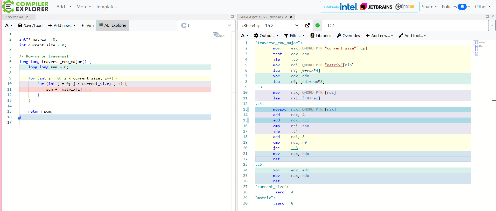
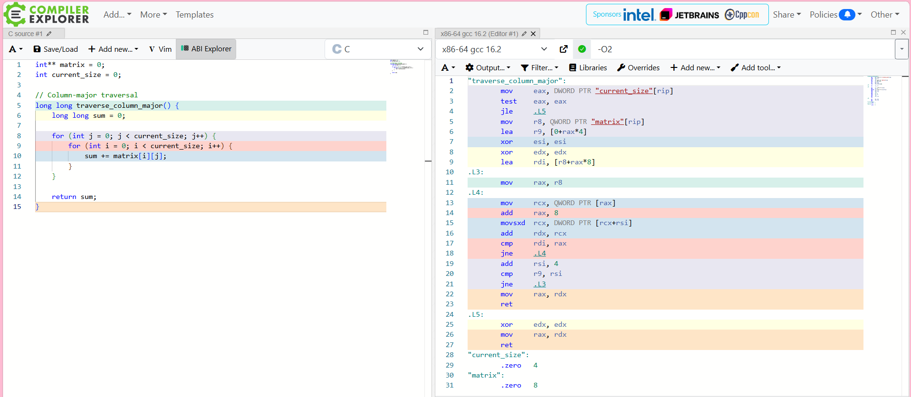

# Assignment 8: Analysis

## Section 1: Performance Measurements

The program was compiled using GCC without additional optimization flags. Both row-major and column-major traversal were tested using four different matrix sizes.

| Matrix Size | Row-Major Time (ms) | Column-Major Time (ms) | Ratio (Column / Row) |
| --- | --- | --- | --- |
| 1000 × 1000 | 4.00 | 4.00 | 1.00× |
| 2000 × 2000 | 10.00 | 10.00 | 1.00× |
| 4000 × 4000 | 32.00 | 108.00 | 3.38× |
| 8000 × 8000 | 137.00 | 371.00 | 2.71× |

**Ratio Calculation:**

Ratio = Column-Major Time ÷ Row-Major Time

For the 4000 × 4000 matrix:

108.00 ÷ 32.00 = 3.38×

**Observations:**

For the two smaller matrix sizes, both traversal methods had identical execution times. However, as the matrix size increased, column-major traversal became noticeably slower. At 4000 × 4000, column-major traversal took approximately 3.38 times as long as row-major traversal. At 8000 × 8000, it took approximately 2.71 times as long.

These results demonstrate how memory access patterns can affect performance, especially when working with larger datasets. Row-major traversal accesses consecutive memory locations, allowing the CPU to use cache lines more efficiently. Column-major traversal jumps between rows, which can result in more cache misses and slower execution.

## Section 2: Compiler Optimization Comparison

The program was compiled and tested using three GCC optimization levels: -O0, -O2, -O3

| Optimization Level | Matrix Size | Row-Major (ms) | Column-Major (ms) | Ratio (Col/Row) |
| --- | --- | --- | --- | --- |
| -O0 | 1000 × 1000 | 4.00 | 4.00 | 1.00× |
| -O0 | 2000 × 2000 | 7.00 | 12.00 | 1.71× |
| -O0 | 4000 × 4000 | 32.00 | 123.00 | 3.84× |
| -O0 | 8000 × 8000 | 151.00 | 365.00 | 2.42× |
| -O2 | 1000 × 1000 | 0.00 | 2.00 | N/A |
| -O2 | 2000 × 2000 | 2.00 | 8.00 | 4.00× |
| -O2 | 4000 × 4000 | 2.00 | 171.00 | 85.50× |
| -O2 | 8000 × 8000 | 30.00 | 729.00 | 24.30× |
| -O3 | 1000 × 1000 | 0.00 | 0.00 | N/A |
| -O3 | 2000 × 2000 | 2.00 | 7.00 | 3.50× |
| -O3 | 4000 × 4000 | 6.00 | 156.00 | 26.00× |
| -O3 | 8000 × 8000 | 27.00 | 749.00 | 27.74× |

**Does -O3 eliminate the performance gap?**

No, -O3 does not eliminate the performance gap between row-major and column-major traversal. Although compiler optimization can improve how instructions are executed, it does not necessarily change the order in which the program accesses memory. Row-major traversal is still faster for larger matrices because it accesses consecutive memory locations, allowing the CPU to use cache lines more efficiently, while column-major traversal causes more cache misses.

## Section 3: Assembly Comparison

**Row-Major Assembly Screenshot:**

**Column-Major Assembly Screenshot:**

**Do the two functions generate significantly different assembly?**

No, both functions generate very similar assembly instructions, including mov, add, cmp, and jne. The main difference is how they move through the matrix. The row-major function increases the address within a row by 4 bytes at a time, while the column-major function moves between rows by advancing through the row pointers.

**If the assembly is similar but performance differs dramatically, what does this tell you about where the performance difference originates?**

This shows that the performance difference mainly comes from how the CPU accesses memory rather than the instructions themselves. In my tests with -O2, row-major traversal took 30 ms for the 8000 × 8000 matrix, while column-major took 729 ms. Row-major traversal benefits from accessing nearby memory locations, while column-major traversal jumps between rows, resulting in less efficient cache usage and potentially more cache misses.

## Section 4: Cache Behavior Explanation

In C, a traditional 2D array is stored in row-major order, meaning the elements in each row are stored next to each other in memory. This makes row-major traversal more efficient because the program accesses the elements in the same order they are stored. In my program, the matrix is created using an int**, with each row allocated separately. Although the entire matrix is not stored in one continuous block, the elements within each row are still stored next to each other. When the program uses row-major traversal, it processes all the elements in one row before moving to the next. Column-major traversal does the opposite by processing the same column across multiple rows before moving to the next column. This means it constantly jumps between different areas of memory instead of accessing nearby elements.

The CPU uses cache memory to avoid having to retrieve data from the slower main memory every time it needs a value. When the CPU accesses an element, it typically loads a 64-byte cache line containing that element and the surrounding data. Since an integer usually takes 4 bytes, one cache line can hold 16 integers. During row-major traversal, the CPU can use the other integers already loaded into the cache because the next elements are stored directly beside the previous ones. The CPU's prefetcher can also recognize this sequential access pattern and begin loading upcoming data before it is needed. During column-major traversal, however, the program moves between different rows with each access. This often requires the CPU to access a different cache line before it has used the remaining values from the previous one. As a result, column-major traversal makes less efficient use of cache lines and can experience more cache misses. This helps explain why my 8000 × 8000 matrix took only 30 ms with row-major traversal but 729 ms with column-major traversal at -O2.

Compiler optimization cannot always fix this problem because changing the order of memory accesses could change how a program behaves. Even though -O2 and -O3 can improve instructions and optimize loops, they do not necessarily reorganize the traversal order. My Compiler Explorer results showed that both functions generated similar assembly instructions, but they still accessed memory differently. This demonstrates that performance depends on more than just compiler optimization. The way a program accesses data can have a major effect on how efficiently the CPU uses its cache, especially when working with large amounts of data.

For my final project, I will be creating a vintage photo filter in C, so understanding cache behavior will help me process images more efficiently. I plan to use a contiguous array of RGB pixel structs to store the image data, allowing me to access pixels in the order they are stored in memory. In the optimized version, I will process pixels sequentially and apply all three color adjustments in a single pass instead of repeatedly reading and writing separate image buffers. This should improve cache efficiency, reduce unnecessary memory accesses, and help the program process larger images faster.
